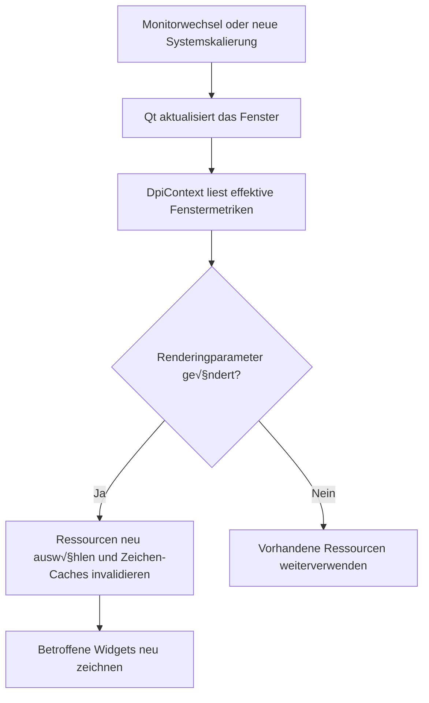

# Implementierungsplan: High DPI und dynamische Monitorskalierung in LMMS

**Stand:** 16. Oktober 2026  
**Analysierter Repository-Stand:** `a2f57e70c`, einschließlich des aktuellen Arbeitsverzeichnisses  
**Status:** Architektur- und Umsetzungsplan; die beschriebenen Änderungen und Tests sind noch umzusetzen.  
**Referenzfall:** Windows, WQHD mit 2560 × 1440 Bildpunkten bei 125 %; zusätzlich mehrere Monitore mit unterschiedlichen Skalierungen.

## 1. Ziel und technische Entscheidung

LMMS soll die im Betriebssystem eingestellte Skalierung automatisch übernehmen. Bei 125 % müssen Bedienelemente, Texte, Icons, Kurven und Editorflächen zusammenpassen. Wird ein Fenster auf einen anders skalierten Monitor verschoben oder die Skalierung des aktuellen Monitors geändert, muss sich die Darstellung während des Betriebs aktualisieren.

Die vorhandene Qt-Widgets-Oberfläche bleibt die Grundlage. Qt übernimmt die Abbildung logischer Oberflächenkoordinaten auf Gerätebildpunkte. LMMS ergänzt eine konsistente Startkonfiguration, fensterbezogene Grafikressourcen, passende Zeichen-Caches und die Behandlung von Monitoränderungen. Ein Umstieg auf QML oder Qt 6 ist dafür keine Voraussetzung.

**Empfohlener Umfang der ersten vollständigen Umsetzung:**

- Systemskalierung einschließlich 125 %, 150 %, 175 % und 200 % unter Windows.
- Dynamischer Wechsel zwischen unterschiedlich skalierten Monitoren.
- Hauptfenster, MDI-Unterfenster, abgelöste Editorfenster, Dialoge, Menüs und selbst gezeichnete LMMS-Bedienelemente.
- Scharfe Vektorgrafiken und korrekt dimensionierte Raster-Caches.
- Ein geprüftes Verhalten für native und ausgelagerte Plugin-Oberflächen; bei inkompatiblen Fremdoberflächen ein funktionierender separater Fenstermodus.
- Erhalt der Qt-5.15- und Qt-6-Buildpfade sowie plattformspezifische Regressionstests.

Ein zusätzlicher, frei wählbarer LMMS-Oberflächenzoom ist eine optionale Folgefunktion. Für einen WQHD-Monitor bei 125 % ist zunächst **keine manuelle Einstellung in LMMS erforderlich**. Die Systemskalierung ist der Standard.

## 2. Befunde im aktuellen Quellcode

Die folgenden Befunde stammen aus semantischen CocoIndex-Suchen und anschließender direkter Prüfung der angegebenen Dateien. Zeilennummern beziehen sich auf den oben genannten Stand.

| Bereich | Nachgewiesener Istzustand | Konsequenz für die Umsetzung |
| --- | --- | --- |
| Qt-Versionen | `CMakeLists.txt:113,264–278`: Qt 5.15 als Mindestversion im Standardpfad; Qt 6 über `WANT_QT6`, mindestens 6.0, bei MSVC mindestens 6.8. | Alle neuen APIs müssen zum jeweiligen Mindeststand passen. Qt-6.6-Ereignisse benötigen Versionsprüfungen. |
| Start | `src/core/main.cpp:363–370`: `AA_EnableHighDpiScaling` wird für Qt 5 bereits vor `MainApplication` gesetzt. | High DPI ist teilweise integriert. Die Arbeit beginnt mit einer Korrektur und Vervollständigung dieses Pfades. |
| Fractional Scaling | Am Startpunkt ist keine explizite `HighDpiScaleFactorRoundingPolicy` vorhanden. | Die tatsächlich verwendete Policy prüfen und für den LMMS-Standard `PassThrough` setzen, damit 1,25 erhalten bleibt. |
| Windows-Manifest | `cmake/nsis/lmms.exe.manifest:5` enthält `dpiAware=false`; `cmake/nsis/CMakeLists.txt:72` installiert die Datei neben der Anwendung. | Manifest und fertige Binärdatei untersuchen. Ein Manifest mit `false` steht dem Ziel entgegen; seine tatsächliche Wirksamkeit hängt vom eingebetteten Manifest und Paket ab. |
| Windows-Ressourcen | `src/CMakeLists.txt:52–61,114–117` kompiliert eine `.rc`-Datei; `cmake/nsis/lmms.rc.in` enthält bisher Icons und Versionsinformationen, keine explizite DPI-Manifestressource. | Eine eindeutige Manifeststrategie für MSVC und MinGW festlegen und das Ergebnis im gebauten Programm prüfen. |
| SVG-Laden | `src/gui/embed.cpp:41–80`: SVGs werden anhand von `QGuiApplication::primaryScreen()->devicePixelRatio()` gerastert. | Ressourcen müssen die Pixeldichte des tatsächlich zeichnenden Fensters erhalten. Der Hauptmonitor ist kein geeigneter globaler Maßstab. |
| Icon-Cache | `src/gui/embed.cpp:107–122`: Schlüssel bestehen aus Name und gegebenenfalls Breite/Höhe. | DPR und aufgelöste Grafikquelle fehlen als Cache-Merkmale. Varianten verschiedener Monitore können sich überschreiben oder falsch wiederverwendet werden. |
| Vorhandener Größenhelfer | `include/embed.h:58–67` bietet `embed::logicalSize()` für Qt 5 und Qt 6. | Diesen Ansatz erweitern und verwenden; bei Rasterrundung die gewünschte logische Größe zusätzlich explizit speichern. |
| Pixmap-Schaltflächen | `src/gui/widgets/PixmapButton.cpp:105–129` verwendet bereits logische Pixmap-Größen, speichert aber fertige Pixmaps. | Gute Basis; nach einem DPR-Wechsel müssen neue Varianten geladen werden können. Das Leeren des globalen Caches ersetzt gespeicherte Pixmap-Kopien nicht. |
| Knob-Cache | `src/gui/widgets/Knob.cpp:386–395`: `QImage(size(), ...)`, Wiederverwendung bei unverändertem Winkel. | Ohne DPR im Gültigkeitszustand bleibt ein zu niedrig aufgelöster Cache auch bei unverändertem Reglerwert bestehen. |
| Clip- und Raster-Caches | `src/gui/clips/SampleClipView.cpp:209–233`, außerdem `MidiClipView`, `PatternClipView`, `AutomationClipView`; `src/gui/tracks/TrackContentWidget.cpp:89–149`. | Rasterziele in Geräteauflösung anlegen, weiterhin mit logischen Koordinaten zeichnen und DPR-Änderungen als Aktualisierungsgrund behandeln. |
| Weitere Grafiknutzer | `LcdWidget.cpp:287–288`, `Draggable.cpp:53,121–125`, `CPULoadWidget.cpp:49–51` leiten Geometrie aus Rasterabmessungen ab. | Nicht pauschal alle Pixmaps hochauflösend ersetzen: zuerst Geometrie und Quellrechtecke dieser Verbraucher auseinanderziehen. |
| Spectrum Analyzer | `plugins/SpectrumAnalyzer/SaControlsDialog.cpp:83–113` berechnet Icon-Rastergrößen mit DPR und verwendet statische Pixmaps; `SaWaterfallView.cpp:148–158` hat eine eigene DPR-Behandlung. | Bestehende Sonderlösungen gezielt integrieren. Statische, beim ersten Fenster erzeugte Grafikvarianten sind für gemischte Monitore ungeeignet. |
| Fractional DPR unter Qt 5 | Die Analyzer-Widgets verwenden `devicePixelRatio()` bzw. `window()->devicePixelRatio()`, etwa `SaSpectrumView.cpp:357`. Bei `QWidget` stammt dieses API unter Qt 5.15 aus `QPaintDevice` und liefert `int`. | Für Widgets `devicePixelRatioF()` oder den fensterbezogenen `qreal`-Helfer verwenden. Eine spätere Zuweisung an `float` stellt verlorene Nachkommastellen nicht wieder her. |
| Schrift und Style | `include/FontHelper.h:31–42` setzt feste Pixel-Schriftgrößen; `LmmsStyle.cpp:338–359` liefert feste Metriken; beide `style.css` mischen `px` und `pt`. | Werte nicht zusätzlich mit dem Betriebssystemfaktor multiplizieren. Textmetriken, Platzbedarf und Schriftänderungen gezielt prüfen. |
| Grafikbestand | `data/themes/default` enthält bei der Bestandsaufnahme 283 PNGs und 14 SVGs. Auch das klassische Theme ist vorhanden. | Ein DPI-Schalter allein liefert keine hochauflösenden Grafikdetails. Grafikqualität und Theme-Kompatibilität sind eigene Arbeitspakete. |
| Ablösbare Fenster | `src/gui/SubWindow.cpp:295–357`: `detach()` und `attach()` ändern Fensterflags und Elternbezug. | Die Bindung an ein natives Fenster kann sich ändern und muss erneuert werden. |
| Gespeicherte Geometrie | `src/gui/MainWindow.cpp:667–726` speichert und restauriert Unterfensterkoordinaten als XML-Attribute. | Logische Geometrie erhalten und auf Erreichbarkeit prüfen; vorhandene Projektdateien nicht pauschal mit einem neuen Faktor umrechnen. |
| VST-Einbettung | `plugins/VstBase/VstPlugin.cpp:788–844`: Qt-Container oder Win32-`SetParent`, anschließend `setFixedSize(m_pluginGeometry)`. | Hier treffen Qt-Koordinaten, native Fenster und vom Plugin gemeldete Größen aufeinander. Ein separater Koordinatenvertrag ist nötig. |
| VST-Hilfsprozess | `plugins/VstBase/RemoteVstPlugin.cpp:817–845,2028–2054`; eigener Build in `plugins/VstBase/RemoteVstPlugin/CMakeLists.txt`. | Die DPI-Konfiguration des Hauptprozesses gilt nicht automatisch für den Hilfsprozess. |
| Weitere Plugins | ZynAddSubFx verwendet einen separaten FLTK-GUI-Pfad in `RemoteZynAddSubFx.cpp`; Carla übergibt in `Carla.cpp:580` eine native Parent-ID. `Lv2ViewBase.cpp` erzeugt LMMS-Steuerelemente. | FLTK, Carla und native Fenster getrennt bewerten. Die LMMS-eigene LV2-Steueransicht über die gemeinsamen Widgets mitprüfen. |
| Splashscreen | `src/gui/GuiApplication.cpp:124–125` setzt eine feste Größe aus `splashScreen.pixmap().size()`. | Bei hochauflösenden Splash-Ressourcen darf die physische Bildgröße nicht zur logischen Fenstergröße werden. |
| Tests und CI | `tests/CMakeLists.txt` registriert QtTest-Programme; vorhandene Tests verwenden `QTEST_GUILESS_MAIN`. `.github/workflows/build.yml` enthält mehrere Plattform- und Qt-Buildpfade. | Neue GUI-Tests benötigen eine `QApplication` und eigene Startparameter; vorhandene Core-Tests allein prüfen die Darstellung nicht. |
| macOS | `cmake/apple/lmms.plist.in` enthält bereits `NSHighResolutionCapable=True`. | Bestehende Unterstützung erhalten und die gemeinsamen Ressourcen-/Cache-Korrekturen auch auf Retina prüfen. |

**Noch nicht nachgewiesen:** Welche dieser Stellen im aktuell installierten LMMS-Build sichtbare Fehler verursachen, welche DPI-Awareness seine fertige EXE tatsächlich hat und welche Fremdplugins mit einer geänderten Awareness kompatibel sind. Diese Punkte werden in Arbeitspaket A reproduziert und gemessen.

## 3. Verbindliches Koordinatenmodell

### 3.1 Logische Pixel und Gerätebildpunkte

Bei aktiviertem High-DPI-Modus arbeitet die Qt-Oberfläche mit geräteunabhängigen Koordinaten. Fenstergeometrie, Widget-Größen und Mausereignisse gehören in diesen logischen Raum. Rasterbilder haben zusätzlich eine tatsächliche Pixelauflösung. Diese Trennung ist in der [Qt-5.15-Dokumentation zu High DPI](https://doc.qt.io/archives/qt-5.15/highdpi.html) beschrieben.

Für den Windows-Referenzfall ohne zusätzliche Overrides gilt:

```text
WQHD-Monitor:                  2560 √ó 1440 physische Bildpunkte
Systemskalierung:              125 %
Effektiver Fenster-DPR:         1,25
Logische Bildschirmgröße:      ungefähr 2048 × 1152
Verfügbare Arbeitsfläche:      zusätzlich um Taskleiste usw. reduziert

Widgetgröße:                   100 × 32 logische Pixel
Geräteauflösung dieses Widgets: 125 × 40 Bildpunkte
```

Maßgeblich sind die zur Laufzeit von Qt gemeldeten Werte. WQHD allein bestimmt keinen Skalierungsfaktor; entscheidend sind die Systemeinstellung und der konkrete Fensterkontext.

| Datenart | Einheit | Regel |
| --- | --- | --- |
| Layoutabstände, Widgetgrößen, Mindestgrößen, Style-Metriken | Logische Pixel | Keine zusätzliche Multiplikation mit DPR. |
| Mauspositionen innerhalb der Qt-Oberfläche | Logische Koordinaten | Direkt für Hit-Tests und Editorinteraktionen verwenden. |
| Puffergröße eines selbst erzeugten UI-Rasterbilds | Physische Bildpunkte | Aus logischer Zielgröße und effektivem DPR berechnen. |
| Sprite-Quellrechteck, Zugriff auf Bilddaten | Pixel der Quelldatei | Quellauflösung gesondert berücksichtigen. |
| Native Win32-/Plugin-Fenstergrößen | Vom jeweiligen API-/Awareness-Kontext abhängig | Nur an einer dokumentierten Systemgrenze umrechnen. |
| Notenzeit, Sampleposition, Frequenz, Automation | Musikalische oder fachliche Einheiten | Von DPI unabhängig halten. |
| Editorzoom, z. B. Taktbreite | Bestehende Zoomdefinition in logischen Pixeln | Nicht bei jedem Monitorwechsel verändern. |
| Optionaler LMMS-Oberflächenzoom | Zusätzlicher Benutzerfaktor | Als eigene Funktion behandeln; Standardwert 1,0. |

### 3.2 Zielgröße nicht aus gerundeten Rastermaßen rekonstruieren

Die gewünschte logische Größe ist führend:

```text
physicalWidth  = ceil(logicalWidth  √ó dpr)
physicalHeight = ceil(logicalHeight √ó dpr)
```

Beispiel: 13 logische Pixel bei DPR 1,25 benötigen einen Puffer von 17 Bildpunkten. `17 / 1,25` ergibt 13,6 und damit nicht exakt die ursprüngliche Zielgröße. Deshalb bleiben Layoutgröße und logisches Zeichenrechteck gesondert gespeichert. Beim Zeichnen wird auf dieses Rechteck begrenzt oder gezielt hineingezeichnet; der zusätzliche Rand darf kein Layoutwachstum auslösen.

Für angrenzende Teilflächen gemeinsame Kanten aus der Gesamtgeometrie berechnen. Nicht jede Teilbreite unabhängig runden und anschließend addieren, da sonst Lücken oder Überlappungen entstehen können.

### 3.3 Regeln für das Zeichnen

- Ein `QPainter` direkt auf einem `QWidget` zeichnet weiterhin in logischen Koordinaten.
- Ein selbst erzeugtes UI-`QImage` oder eine UI-`QPixmap` erhält den physischen Puffer und **vor dem Erzeugen des Painters** den dazugehörigen DPR.
- Anschließend zeichnet LMMS auch in diesen Puffer mit logischen Koordinaten. Ein zusätzliches `painter.scale(dpr, dpr)` würde denselben Faktor erneut anwenden.
- `setDevicePixelRatio()` erzeugt keine zusätzlichen Details. Es beschreibt die Bedeutung bereits vorhandener Rasterpixel; die Pufferauflösung muss dazu passen.
- Bei Sprite-Zugriffen unterscheiden sich das logische Zielrechteck und das Quellrechteck im Rasterbild.
- Fachliche Datenbilder, etwa ein FFT-/Wasserfallpuffer mit Frequenzbins und Historienzeilen, behalten ihre fachliche Auflösung. Ihre Darstellung wird an das Zielrechteck angepasst.

Die Wirkung des DPR auf Painter und Layoutgröße dokumentieren [QPixmap::setDevicePixelRatio](https://doc.qt.io/qt-6.8/qpixmap.html#setDevicePixelRatio) und [QImage::setDevicePixelRatio](https://doc.qt.io/qt-6.8/qimage.html#setDevicePixelRatio).

Eine Linie von einem logischen Pixel kann bei 125 % nicht überall auf einer ganzzahligen Anzahl physischer Pixel liegen. Erwartet werden saubere, konsistente Antialiasing-Ergebnisse; physische Ein-Pixel-Linien sind nur für bewusst gewählte Haarlinien sinnvoll. Keine globale Korrektur aller Zeichenkoordinaten um `0.5` einbauen.

### 3.4 DPR-APIs versions- und objektspezifisch verwenden

Für Qt-5-kompatiblen Widgetcode ist `devicePixelRatioF()` entscheidend: Der [Qt-5.15-Header von QPaintDevice](https://raw.githubusercontent.com/qt/qtbase/5.15/src/gui/painting/qpaintdevice.h) unterscheidet ausdrücklich den ganzzahligen Aufruf und dessen Fließkommavariante. Im [Qt-6.8-Header](https://raw.githubusercontent.com/qt/qtbase/6.8/src/gui/painting/qpaintdevice.h) liefern beide einen Fließkommawert. Der Fehler kann deshalb je nach Qt-Build unterschiedlich sichtbar sein.

`QWindow`, `QScreen`, `QPixmap` und `QImage` besitzen eigene DPR-Schnittstellen. Bei einem Audit deshalb den konkreten Objekttyp prüfen und nicht jeden gleichnamigen Aufruf pauschal ersetzen. Den Faktor durchgängig als `qreal` führen; erst die tatsächlichen Rasterabmessungen auf ganze Bildpunkte bringen.

## 4. Geplante Architektur und Verantwortlichkeiten

### 4.1 Startkonfiguration

Der prozessweite Qt-Startpunkt bleibt `src/core/main.cpp`, unmittelbar vor dem Erzeugen der Anwendung. Dort werden ausschließlich die erforderlichen globalen Voraussetzungen gesetzt.

Für den GUI-Pfad ist folgende Konfiguration vorgesehen:

```cpp
// Entwurf für den bestehenden Startpunkt, vor MainApplication:
#if QT_VERSION < QT_VERSION_CHECK(6, 0, 0)
QCoreApplication::setAttribute(Qt::AA_EnableHighDpiScaling);
QCoreApplication::setAttribute(Qt::AA_UseHighDpiPixmaps);
#endif

QGuiApplication::setHighDpiScaleFactorRoundingPolicy(
    Qt::HighDpiScaleFactorRoundingPolicy::PassThrough);
```

Die zweite Qt-5-Option unterstützt insbesondere Qt-Iconpfade. Sie repariert nicht automatisch die selbst erzeugten Rasterbilder oder deren Verbraucher.

Die Rounding-Policy muss vor der Anwendungserzeugung gesetzt werden; vorhandene Qt-Umgebungsvariablen sind bei der Diagnose zu berücksichtigen. Das API-Verhalten ist unter [QGuiApplication::setHighDpiScaleFactorRoundingPolicy](https://doc.qt.io/qt-6/qguiapplication.html#setHighDpiScaleFactorRoundingPolicy) dokumentiert. Qt 5 und Qt 6 haben unterschiedliche Standardrichtlinien, wie der [Qt-6-Portierungsleitfaden](https://doc.qt.io/qt-6.5/portingguide.html#high-dpi) erläutert.

Die Arbeit darf den `coreOnly`-Pfad nicht von einem Bildschirm, `QPixmap` oder einer GUI-Initialisierung abhängig machen. Die Startlogik entsprechend eingrenzen und CLI-Rendering mitprüfen.

### 4.2 Fensterbezogener DPI-Kontext

Vorgeschlagene neue Dateien:

- `include/DpiContext.h`
- `src/gui/DpiContext.cpp`

Die Namen sind Entwurfsnamen. Vor der Implementierung prüfen, ob eine passende bestehende Hilfsklasse erweitert werden kann. Neue Quellen in die vorhandenen CMake-Listen aufnehmen.

Verantwortlichkeiten:

1. Den aktuellen nativen Fensterbezug eines LMMS-Top-Level-Widgets kennen.
2. Den effektiven `qreal`-DPR dieses Fensters auslesen.
3. Zugehörige Screen-Signale verwalten und beim Monitorwechsel neu verbinden.
4. Tatsächliche Änderungen zusammenfassen und an betroffene Ressourcen-/Cache-Nutzer melden.
5. Bei Ablösen, erneutem Einbetten, Window-ID-Wechsel und Schließen sauber neu binden bzw. trennen.

Vorgeschlagene begrenzte Oberfläche:

```cpp
// API-Skizze; Details und Namen während der Implementierung festlegen.
qreal effectiveDevicePixelRatio(const QWidget* widget);
QSize rasterSizeFor(QSizeF logicalSize, qreal dpr);

// DpiContext gehört zum jeweiligen Top-Level-Fenster.
// Signal bei einer relevanten Änderung:
// renderingMetricsChanged();
```

**DPR-Quelle:** Das tatsächlich zeichnende Widget über `devicePixelRatioF()` bzw. dessen `QWindow` ist führend. `QWindow::devicePixelRatio()` ist fensterbezogen; seine Semantik und das DPR-Ereignis beschreibt die [QWindow-Dokumentation](https://doc.qt.io/qt-6.8/qwindow.html#devicePixelRatio). Ein Screen-Wert ist ein Fallback vor Verfügbarkeit des nativen Fensters, kein Ersatz für den laufenden Fensterkontext.

Für Ressourcen ohne Fensterkontext muss der Aufrufer entweder einen DPR explizit übergeben oder eine dokumentierte vorläufige Variante erhalten. Spätestens beim Anzeigen muss die Ressource an den wirklichen Kontext gebunden werden. Kein unbemerkter globaler Rückfall auf den Hauptmonitor.

### 4.3 Ereignisse und Lebenszyklus

| Ereignis oder Zustand | Geplante Reaktion |
| --- | --- |
| `QWindow::screenChanged(QScreen*)` | Alten Screen trennen, neuen Screen binden, Aktualisierung einplanen. |
| `QScreen::logicalDotsPerInchChanged` | Effektive Fenstermetriken erneut lesen; nicht selbst `dpi / 96` als allgemeine DPR-Formel verwenden. |
| `QScreen::geometryChanged` / `availableGeometryChanged` | Arbeitsfläche und gegebenenfalls Fenstererreichbarkeit prüfen. Raster nur bei einer wirklichen Änderung ihrer Parameter erneuern. |
| `QGuiApplication::screenAdded` / `screenRemoved` | Verbindungen und betroffene Fenster überprüfen; entfernte Screen-Objekte nicht weiter benutzen. |
| `QEvent::DevicePixelRatioChange`, Qt ≥ 6.6 | DPR und betroffene Grafiken aktualisieren. Mit `QT_VERSION_CHECK(6, 6, 0)` schützen. |
| Show, Resize, Änderung des nativen Fensterbezugs | Günstige Vergleichsprüfung der aktuellen Metriken; bei neuem Handle erneut verbinden. |
| Font-, Palette- oder Style-Änderung | Betroffene Textmaße bzw. Grafik-Caches invalidieren; kein fiktiver Monitorwechsel erforderlich. |
| Paint eines gecachten Widgets | Größe/DPR/Style gegen gespeicherte Cache-Merkmale prüfen. Dies sichert auch ältere Qt-Pfade und übersehene Ereignisfolgen ab. |

Die [QScreen-Referenz](https://doc.qt.io/qt-6.8/qscreen.html) beschreibt die Screen-Signale. `QEvent::DevicePixelRatioChange` gibt es erst seit Qt 6.6, siehe [QEvent](https://doc.qt.io/qt-6.8/qevent.html#Type-enum). Kein nicht vorhandenes `QScreen::devicePixelRatioChanged`-Signal einplanen und keine privaten Qt-APIs voraussetzen.

Qt 5.15 und Qt 6.0–6.5 benötigen den öffentlichen Signalpfad plus die beschriebenen Vergleichsprüfungen. Eine geänderte Skalierung desselben Monitors muss ausdrücklich getestet werden; `screenChanged` allein deckt sie nicht ab.

Ereignisse per queued Aufruf zusammenfassen, damit Qt die native Änderung zuerst verarbeiten kann. Bei unveränderten Metriken nichts neu erzeugen. Beim Zeichnen muss ein falscher Cache trotzdem sofort als ungültig erkannt werden. Keine globale Schleife, die bei jeder Mausbewegung die gesamte Oberfläche neu aufbaut.



**Mehrfensterregel:** Ein abgelöster Mixer auf 100 % und die Piano Roll auf 150 % müssen gleichzeitig korrekt sein. Ein globaler Wert wie `currentDpr` für alle LMMS-Fenster ist ungeeignet. MDI-Kinder teilen grundsätzlich den nativen Kontext ihres Elternfensters; abgelöste Fenster besitzen ihren eigenen.

### 4.4 Gemeinsamer Ressourcen- und Rasterpfad

`embed` bleibt der Einstieg für Theme-Ressourcen. Die Erweiterung soll kompatible neue Überladungen oder Request-Objekte anbieten, beispielsweise:

```cpp
// Neue API-Skizze neben der bestehenden Schnittstelle:
struct PixmapRequest
{
    QSize logicalSize;
    qreal devicePixelRatio;
};

// resourceName berücksichtigt wie bisher Plugin- und Theme-Namensräume.
// getIconPixmapFor(resourceName, request, optionalXpm);
```

Die vorhandene exportierte Signatur sowie `PixmapLoader`, `PluginPixmapLoader` und `PLUGIN_NAME::getIconPixmap()` nicht stillschweigend inkompatibel ersetzen. Den bisherigen Aufrufpfad dokumentieren und Verbraucher schrittweise auf einen expliziten Kontext umstellen.

Ein Cache-Schlüssel muss mindestens unterscheiden:

```text
aufgelöste Grafikquelle bzw. Theme-Generation
+ Plugin-/Ressourcenidentität
+ gewünschte logische Zielgröße
+ effektiver DPR in einer stabilen, konsistenten Darstellung
+ relevante Renderingvariante, z. B. aktiv/inaktiv
```

Fließkommazahlen nicht über eine zufällige Locale in Schlüssel schreiben. Eine mögliche Normalisierung muss innerhalb einer kleinen Toleranz liegen und für Schlüssel, Pufferberechnung und DPR-Metadaten konsistent sein. Faktoren nicht auf ganze Zahlen runden.

SVG-Dateien direkt in die benötigte Auflösung rendern. Bei geeigneten Standard-Buttons und Menüs einen `QIcon` aus der ursprünglichen Ressource verwenden, damit die Quelle erhalten bleibt. Für selbst gezeichnete Widgets bleibt der explizite Pixmap-Pfad erforderlich. Hochauflösende Iconvarianten behandelt [QIcon: High DPI Icons](https://doc.qt.io/qt-6.8/qicon.html#high-dpi-icons); das eigene `embed`-Ladesystem muss entsprechende Varianten selbst korrekt auflösen.

## 5. Arbeitspakete mit konkreten Ergebnissen

Alle Checkboxen beschreiben noch ausstehende Implementierungsarbeit. Ein Paket gilt erst als abgeschlossen, wenn seine Abnahmekriterien erfüllt sind.

### A — Ausgangszustand reproduzieren und messen

**Priorität:** P0. **Abhängigkeiten:** keine.

- [ ] Einen Qt-5.15-Build und den vorhandenen Windows-Qt-6-Buildpfad identifizieren bzw. erstellen; Compiler, Qt-Version, Plattformplugin und Pakettyp festhalten.
- [ ] WQHD bei 100 % und 125 % starten und mit einem zweiten Monitor bei 100 % vergleichen.
- [ ] Hauptfenster, Einstellungen, Piano Roll, Mixer, Instrumentenfenster und Spectrum Analyzer erfassen.
- [ ] Prüfen, ob Windows-Kompatibilitätseinstellungen oder vorhandene `QT_*`-Overrides den Lauf beeinflussen.
- [ ] Die effektive DPI-Awareness der fertigen EXE und betroffener Plugin-Hilfsprozesse prüfen; das tatsächlich eingebettete Manifest auslesen.
- [ ] Vorläufige Diagnoseausgabe für Qt-Version, Plattform, Rounding-Policy, Screen, Fenster-DPR, logische DPI und Fenstergröße ergänzen.
- [ ] Reproduktion für „Start direkt auf 125 %“, „100 % → 125 %“ und „Skalierung desselben Monitors ändern“ dokumentieren.

Diagnosen laufen bei Änderungen, nicht in jeder Paint-Iteration. Bildschirmnamen und Umgebungswerte nur in einem bewusst erzeugten lokalen Diagnoseprotokoll erfassen.

**Abnahme:** Für jeden sichtbaren Defekt sind Build, Schritte, erwartete Darstellung und gemessene Metriken bekannt. Manifestkonflikte und niedrige Rasterauflösung lassen sich getrennt beurteilen.

### B — Qt-Start und Windows-Paket konsistent konfigurieren

**Priorität:** P0. **Abhängigkeit:** A.

**Betroffene Dateien:** `src/core/main.cpp`, `cmake/nsis/lmms.exe.manifest`, `cmake/nsis/lmms.rc.in`, `cmake/nsis/CMakeLists.txt`, `src/CMakeLists.txt`.

- [ ] Die in Abschnitt 4.1 beschriebene Startkonfiguration ergänzen.
- [ ] Den Standard `PassThrough` auf beiden Qt-Pfaden sicherstellen und tatsächlich gemessenen DPR protokollieren.
- [ ] `dpiAware=false` aus dem wirksamen Windows-Paket beseitigen.
- [ ] Im Anwendungsmanifest eine moderne Per-Monitor-V2-Anforderung mit geeigneten Fallbacks für die unterstützten Systeme vorsehen.
- [ ] Das Manifest in die EXE einbetten, damit Buildverzeichnis, Installation und portable Ausgabe denselben Ausgangspunkt besitzen.
- [ ] Für MinGW den Ressourcenpfad und für MSVC den Manifest-/Linkerpfad prüfen; nur eine konsistente wirksame Manifestressource erzeugen.
- [ ] Das installierte Sidecar-Manifest entfernen oder mit derselben Quelle generieren. Keine zweite, abweichende DPI-Konfiguration ausliefern.
- [ ] Den Build von einer Manifeständerung abhängig machen; die aktuelle MinGW-Resource-Regel muss Änderungen zuverlässig neu kompilieren.
- [ ] Vorhandene andere Manifestinhalte, Versionsressourcen und Icons erhalten.

Vorgesehener Inhalt innerhalb der bestehenden `windowsSettings`-Struktur:

```xml
<dpiAware xmlns="http://schemas.microsoft.com/SMI/2005/WindowsSettings">true/pm</dpiAware>
<dpiAwareness xmlns="http://schemas.microsoft.com/SMI/2016/WindowsSettings">PerMonitorV2,PerMonitor</dpiAwareness>
```

Die Auswahl und Fallbacks sind gegen die unterstützten Windows-Versionen zu prüfen. Microsoft beschreibt Manifest-Priorität und die frühe Festlegung der Awareness unter [Setting the default DPI awareness for a process](https://learn.microsoft.com/en-us/windows/win32/hidpi/setting-the-default-dpi-awareness-for-a-process). Keine späte prozessweite Umschaltung in `MainWindow` ergänzen; Qt soll seine nativen DPI-Nachrichten weiterhin selbst verarbeiten.

Bei MSVC zunächst prüfen, wie CMake und der Linker Manifeste zusammenführen. Keine doppelte `RT_MANIFEST`-Ressource erzeugen und die automatische Manifesterzeugung nicht ohne Prüfung ihrer übrigen Inhalte deaktivieren.

**Abnahme:** Das tatsächliche Windows-Fenster ist im geplanten Awareness-Modus. WQHD bei 125 % liefert ohne Overrides DPR 1,25. Ein logisches Testelement von 100 × 32 belegt 125 × 40 Gerätebildpunkte. Qt-5-/Qt-6-Build und CLI-Pfad funktionieren.

### C — `embed` und seine Verbraucher für mehrere DPRs vorbereiten

**Priorität:** P0. **Abhängigkeiten:** A; enge Abstimmung mit D und E.

**Betroffene Dateien:** `include/embed.h`, `src/gui/embed.cpp`, gemeinsame Bildverbraucher, Theme-/Ressourcen-CMake-Dateien.

- [ ] Neue kontextfähige API wie in Abschnitt 4.4 einführen, bestehende Signaturen zunächst erhalten.
- [ ] Den Hauptmonitorzugriff aus dem eigentlichen SVG-Rasterpfad entfernen; der DPR wird übergeben.
- [ ] Logische Wunschgröße, physische Puffergröße und DPR separat führen.
- [ ] Cache-Schlüssel erweitern; gleichzeitig mehrere Varianten derselben Grafik zulassen.
- [ ] Bestehende Theme-Suchreihenfolge erhalten: gewähltes Theme, Default-Theme, eingebettete Ressourcen.
- [ ] Quellenidentität bzw. eine Theme-Generation berücksichtigen, damit gleichnamige Ressourcen nach einem Themewechsel nicht vermischt werden.
- [ ] Für PNGs eine definierte Strategie für Originalgröße und hochauflösende Varianten einführen. `@2x`-Unterstützung im eigenen Loader ausdrücklich implementieren und testen, falls sie verwendet wird.
- [ ] Für PNG/SVG/XPM dieselbe Größenbedeutung der neuen API dokumentieren.
- [ ] Leere Namen, fehlende Dateien, ungültige SVGs und Aufrufe ohne gültigen Screen robust behandeln; keine ungeschützte `primaryScreen()`-Dereferenz.
- [ ] `QPixmap` und `QPixmapCache` nur im GUI-Thread verwenden. Eventuelle parallele Rastervorbereitung auf geeignete `QImage`-Arbeit begrenzen und separat synchronisieren.

**Verbraucher vor der Umstellung prüfen:** `PixmapButton`, `LcdWidget`, `LcdFloatSpinBox`, `Draggable`, `CPULoadWidget`, Toolbar-/Menü-Icons, `TrackGrip`, Splashscreen, Drag-Vorschaubilder und Plugin-`PixmapLoader`.

Bei `LcdWidget` sind Zellen und Ränder logische Maße, während das Ausschneiden der Zeichen in Quellpixeln erfolgt. Neue hochauflösende Sprites benötigen dafür passende Quelldaten oder definierte Metadaten. Die aktuelle Ableitung aus `m_lcdPixmap.size()` darf nicht unverändert übernommen werden.

**Abnahme:** Dieselbe Grafik kann zugleich bei DPR 1,0 und 1,25 geladen werden. Die logische Button-/LCD-Größe bleibt gleich. Quellen und Cachevarianten bleiben getrennt, und bei Themes ohne hochauflösende Varianten bleiben Größe und Funktion korrekt.

### D — Dynamischen Fensterkontext integrieren

**Priorität:** P0. **Abhängigkeiten:** B und C für die vollständige Wirkung.

**Betroffene Dateien:** vorgeschlagener `DpiContext`, `src/gui/MainApplication.cpp`, `src/gui/GuiApplication.cpp`, `src/gui/MainWindow.cpp`, `src/gui/SubWindow.cpp` und zugehörige Header.

- [ ] Die öffentlichen Signale und Versionspfade aus Abschnitt 4.3 implementieren.
- [ ] Alle LMMS-Top-Level-Fenster erfassen, einschließlich später geöffneter Dialoge und abgelöster Editoren.
- [ ] Vor dem ersten nativen Handle vorläufigen Zustand erlauben; beim Show-/Handle-Ereignis endgültig binden.
- [ ] Beim `detach()`/`attach()` die zuständige Fensterbindung und ihre Verbindungen erneuern.
- [ ] Screen-Zeiger mit geeignetem Qt-Lebenszyklus absichern; Verbindungen bei Wechsel, Zerstörung und Hotplug trennen.
- [ ] Änderungen pro Fenster zusammenfassen und nur registrierte, betroffene Verbraucher benachrichtigen.
- [ ] Grafiken in bereits sichtbaren und später wieder eingeblendeten Widgets erneuern.
- [ ] Paint-seitige Cacheprüfung als Absicherung ergänzen; kein dauerhaftes globales Polling.
- [ ] Menüs, Tooltips und Drag-Vorschauen an Monitorgrenzen mitprüfen.

Ein globales `QPixmapCache::clear()` ist höchstens eine ergänzende Maßnahme beim Themewechsel. Es genügt nicht für `static QPixmap`, Member-Kopien oder bereits an Labels übergebene Pixmaps. Solche Verbraucher brauchen eine Ressourcenbeschreibung, einen geeigneten `QIcon` oder einen expliziten Reload-Pfad.

**Abnahme:** Bereits geöffnete Fenster wechseln 100 % → 125 % → 150 % → 100 % ohne Neustart korrekt. Zwei unabhängige Top-Level-Fenster auf unterschiedlichen Monitoren beeinflussen ihre Grafikvarianten nicht gegenseitig. Handle-Neuerzeugung und Monitorentfernung führen nicht zu ungültigen Referenzen.

### E — Selbst gezeichnete Widgets und Raster-Caches umstellen

**Priorität:** P0 für Kernoberfläche, P1 für weitere Pluginansichten. **Abhängigkeiten:** C und D.

**Gemeinsamer Gültigkeitszustand eines UI-Caches:**

```text
logische Zielgröße
+ tatsächliche Rastergröße
+ DPR
+ relevante Schrift-/Palette-/Style-Generation
+ fachlicher Darstellungszustand, z. B. Wert, Zoom oder Auswahl
```

Ein Cache mit unverändertem Reglerwert ist nach einem DPR-Wechsel trotzdem veraltet. Derselbe Grundsatz gilt für unveränderte Clips, Raster und Kurven.

| Reihenfolge | Stellen | Konkrete Arbeit |
| --- | --- | --- |
| E1 | `Knob.cpp`, `include/Knob.h` | Puffer passend zur logischen Größe anlegen; DPR vor dem Painter setzen; Gültigkeit vor dem bisherigen Early Return prüfen; Schrift-/Style-/Größenänderungen einbeziehen. |
| E2 | `PixmapButton`, `LcdWidget`, `LcdFloatSpinBox`, `CPULoadWidget`, `Draggable`, `Fader` | Logische Geometrie, Sprite-Ausschnitte, Griffpositionen und Hit-Tests prüfen; Grafiken nach Kontextwechsel neu auswählen. |
| E3 | `TrackContentWidget.cpp`, `MidiClipView.cpp`, `PatternClipView.cpp`, `AutomationClipView.cpp`, `SampleClipView.cpp` | Hintergrund- und Clip-Pixmaps in Zielauflösung erzeugen; DPR in Größen-/Dirty-Prüfungen aufnehmen; beim Kacheln logische Abstände erhalten. |
| E4 | `PianoRoll.cpp`, `AutomationEditor.cpp`, `TimeLineWidget.cpp`, `PianoView.cpp`, `Graph.cpp`, Envelope-/LFO-Graphen | Paint und Eingabe zusammen prüfen; DPI nicht mit musikalischem Zoom verwechseln; Cursor und Auswahlrahmen kontrollieren. |
| E5 | `plugins/Eq/EqCurve.cpp`, `plugins/Compressor/CompressorControlDialog.*` | Kurven-/Graph-Caches prüfen, bei Bedarf hochauflösend erzeugen oder direkt im logischen Painter zeichnen. |
| E6 | `AudioFileProcessorWaveView.cpp`, `SlicerTWaveform.cpp`, `SampleThumbnail.cpp` | Darstellungsraster von fachlichen Peak-/Sampledaten trennen; sichtbare Auflösung verbessern, ohne Audiodaten neu zu berechnen. |
| E7 | `SaControlsDialog.cpp`, `SaSpectrumView.cpp`, `SaWaterfallView.cpp` | Ganzzahlige Widget-DPR-Aufrufe für Qt 5 ersetzen; statische DPR-Varianten beseitigen; Sonderpfade auf Doppelanwendung oder falschen Kontext prüfen; Datenauflösung des Wasserfalls erhalten. |

Für `SampleThumbnail` bleiben die vorhandenen Aggregationsdaten grundsätzlich DPI-unabhängig. Falls die Darstellung pro Gerätebildpunkt mehr Details benötigt, ist das ein eigener Sampling-Schritt in der Visualisierung. Nicht den gesamten Sample-Cache pro Monitor vervielfachen.

Für den Spectrum Analyzer ist gesondert zu unterscheiden: `buttonSize` kann eine physische Rasterzielgröße sein, eine an das Layout übergebene Größe muss dagegen logisch bleiben. Das Vorkommen von `* devicePixelRatio()` allein beweist noch keine Doppelskalierung.

**Abnahme:** Auch ruhende Regler, unveränderte Clips und offene Pluginansichten werden nach dem Monitorwechsel scharf neu gezeichnet. Kachelraster zeigen keine neuen Nähte, Sprite-Zellen keine falschen Ausschnitte und Eingaben keinen Versatz.

### F — Layout, Schrift und Theme-Grafiken vervollständigen

**Priorität:** P1, Teil des vollständigen Benutzerergebnisses. **Abhängigkeiten:** B bis E.

- [ ] `LmmsStyle::pixelMetric()` als logische Maße behandeln; keine pauschale Multiplikation mit DPR ergänzen.
- [ ] `FontHelper.h` und CSS-Schriftgrößen prüfen. Pixelbasierte Schrift ist im Qt-High-DPI-Koordinatenmodell nicht automatisch falsch.
- [ ] `QFontMetrics`/`QFontMetricsF` der tatsächlich verwendeten Schrift für Platzbedarf verwenden; FontChange korrekt behandeln.
- [ ] Feste Textcontainer, Werkzeugleisten, LCD-Bereiche, Einstellungen und Effekt-/Instrumentendialoge auf Abschneiden untersuchen.
- [ ] Starre Mindestgrößen dort abbauen, wo sie Inhalte bei kleiner logischer Arbeitsfläche unerreichbar machen. Layouts und Scrollbereiche gezielt nutzen.
- [ ] `default` und `classic` prüfen; die bisherige Darstellung bei 100 % als Vergleich erhalten.
- [ ] Häufig sichtbare Grafiken priorisieren: Transport, Toolbar, Track-Operationen, Regler-/Faderdarstellung, LCD, Fensterbuttons.
- [ ] Einfache Icons als echte Vektorgrafik bereitstellen, wo das zum vorhandenen Design passt. Raster-Skins bei Bedarf mit echten höher aufgelösten Quellen ergänzen.
- [ ] Hochskalierte 1√ó-PNGs nur als kompatiblen Fallback behandeln. `SmoothTransformation` erzeugt keine fehlenden Details.
- [ ] Theme-Fallbacks und die Ressourcenauslieferung für zusätzliche Assets prüfen; reine Dateiergänzung ohne Aufnahme in Ressourcen/Paket reicht nicht.
- [ ] Splashscreen-Größe, Fenstericons und Drag-Hotspots in logischen Koordinaten festlegen.

**Abnahme:** Bei 125 % und 150 % passen Text und Bedienelemente zusammen. Die Einstellungsbuttons bleiben erreichbar. Die wichtigsten gemeinsamen UI-Grafiken besitzen geeignete Quellen; verbleibende 1×-Theme-Grafiken sind konkret inventarisiert und ihre Qualität ist bewertet.

### G — Fensterpositionen und gespeicherte Geometrie robust behandeln

**Priorität:** P1. **Abhängigkeiten:** D und F.

**Betroffene Dateien:** insbesondere `MainWindow.cpp`, `SubWindow.cpp` und die tatsächlichen weiteren Speicher-/Wiederherstellungspfade.

- [ ] Vorhandene XML-Geometrie als bestehende logische LMMS-Geometrie weiterverwenden.
- [ ] Koordinatenursprung unterscheiden: MDI-Fläche und globale Bildschirmkoordinaten sind verschiedene Räume.
- [ ] Nach dem Wiederherstellen Sichtbarkeit und Bedienbarkeit prüfen; abgelöste Fenster mit den verfügbaren Monitorflächen abgleichen.
- [ ] Bei fehlendem Monitor einen geeigneten verbleibenden Screen auswählen und Fenster erreichbar platzieren.
- [ ] Normale Größe, maximierten Zustand und eventuell gespeicherte Detached-Zustände getrennt behandeln.
- [ ] Während eines normalen Monitorwechsels Größen nicht fortlaufend durch `newDpr / oldDpr` skalieren. Die logische Größe soll stabil bleiben, solange die Arbeitsfläche dies erlaubt.
- [ ] Auf Wayland die eingeschränkte Kontrolle globaler Fensterpositionen respektieren und vorhandene Workarounds erhalten.

Bei gemischter Skalierung können logische Bildschirmrechtecke unter Windows Lücken haben. Deshalb die einzelnen Screens verwenden und keinen lückenlosen Desktop annehmen; dies beschreibt [Qt High DPI: Virtual Desktop Geometry](https://doc.qt.io/qt-6.8/highdpi.html#virtual-desktop-geometry).

**Abnahme:** Alte Projekte lassen sich öffnen, Fenster bleiben erreichbar, und Wechsel hin und zurück vergrößern die Geometrie nicht schrittweise. Ablösen und erneutes Einbetten funktionieren auf den getesteten Monitoren.

### H — Native und ausgelagerte Plugin-Oberflächen integrieren

**Priorität:** P1; mit einem frühen Machbarkeitstest bereits nach B beginnen. **Abhängigkeiten:** A/B, später D/G.

Die Qt-Skalierung kann das interne Zeichnen fremder Pluginfenster nicht allgemein korrigieren. Ziel dieses Pakets ist ein klarer Vertrag zwischen LMMS und der jeweiligen Oberfläche sowie ein bedienbarer Ausweichpfad.

#### H1. VST-Haupt- und Hilfsprozess

- [ ] `IdVstPluginEditorGeometry`, `effEditGetRect`, `audioMasterSizeWindow` und die Containergröße gemeinsam verfolgen.
- [ ] Für jede Embed-Methode feststellen, in welchem Koordinaten-/Awareness-Kontext die gemeldeten Maße gelten.
- [ ] Die tatsächliche Awareness von `RemoteVstPlugin32` und `RemoteVstPlugin64` prüfen; nicht vom Hauptprozess ableiten.
- [ ] Den Vertrag für native Clientgröße, logische Qt-Containergröße und Rückmeldungen des Plugins schriftlich festlegen.
- [ ] Erst danach nötige Konvertierungen an einer gemeinsamen Grenze implementieren. Keine unbedingte Multiplikation aller Pluginmaße mit DPR.
- [ ] Falls ein Protokollzusatz benötigt wird, Einheit und Kompatibilität zwischen Host und Hilfsprozess explizit behandeln.
- [ ] Resize-Schleifen vermeiden: vom Plugin gemeldete Änderung und die darauf folgende Hostreaktion dürfen sich nicht endlos gegenseitig auslösen.
- [ ] Für echte native Hilfsfenster prüfen, ob deren DPI-Nachrichten bzw. Rahmengrößenbehandlung angepasst werden müssen. Dies ist unabhängig von Qt im Hauptprozess.
- [ ] Qt-Container, Win32-Einbettung und vorhandenen separaten Fenstermodus jeweils testen.

Bei `SetParent` können unterschiedliche DPI-Awareness-Modi unerwartetes Verhalten oder Fehler verursachen. Die Folgen sind vom Prozess- und Windows-Kontext abhängig; sie sind in der [Microsoft-Referenz zu SetParent](https://learn.microsoft.com/en-us/windows/win32/api/winuser/nf-winuser-setparent) beschrieben. Daher einen Fehler nach der Umstellung nicht mit blindem Nachskalieren verdecken.

#### H2. Weitere Oberflächen

- [ ] ZynAddSubFx/FLTK separat auf Schrift, Größe, Hostbezug und Monitorwechsel testen; keine Wirkung der Qt-Widget-Änderungen unterstellen.
- [ ] Carla-integrierte und separat angezeigte Pluginfenster prüfen, einschließlich der übergebenen Parent-ID.
- [ ] LMMS-generierte LV2-, LADSPA- und andere gemeinsame Kontrollansichten über die korrigierten LMMS-Widgets testen.
- [ ] Eventuelle weitere native UI-Pfade erst nach Nachweis in den konkreten Dateien in dieselbe Matrix aufnehmen.

**Abnahme:** Jeweils ein DPI-fähiger und ein älterer Plugin-Editor sind getestet, soweit entsprechende Testplugins verfügbar sind. Größenänderung, Klickposition und Schließen funktionieren. Ein inkompatibles eingebettetes Fremdfenster kann über den vorhandenen separaten Fenstermodus bedient werden; die betroffene Kombination wird dokumentiert.

Die vollständige Schärfe jedes historischen Fremdplugins kann LMMS nicht garantieren. Die eigene Oberfläche darf durch dessen Einschränkungen jedoch keinen global falschen Skalierungsfaktor erhalten.

### I — Option: eigener LMMS-Oberflächenzoom

**Priorität:** P2, ausdrücklich nach der automatischen Monitorskalierung. **Abhängigkeiten:** B bis H.

Nur einplanen, wenn eine zusätzliche Produktentscheidung dafür getroffen wird. Der Standard bleibt „Systemeinstellung verwenden“.

Ein Benutzerfaktor verändert logische Designmaße und Schriftgrößen; Qt bildet das Ergebnis anschließend auf Gerätebildpunkte ab:

```text
physische Größe = logisches Basismaß × LMMS-Benutzerzoom × Fenster-DPR
```

Beispiel: Basismaß 100, Benutzerzoom 1,1 und Fenster-DPR 1,25 ergeben 137,5 Gerätebildpunkte vor Rasterrundung. Dieser Faktor darf nicht zusätzlich über mehrere unabhängige Mechanismen gesetzt werden.

Vorgesehene Schritte:

- [ ] Eine gemeinsame `UiMetrics`-Abstraktion für Designmaße entwickeln, falls dafür nach F noch Bedarf besteht.
- [ ] Einstellungen in `SetupDialog` und `ConfigManager` ergänzen; ungültige Werte begrenzen und Standard 1,0 verwenden.
- [ ] Themes, Schrift, Mindestgrößen, Grafikquellen und individuelle Pluginansichten für den Zusatzfaktor prüfen.
- [ ] Entscheiden, ob Änderungen sofort gelten oder zunächst einen Neustart erfordern. Dynamischer Monitorwechsel bleibt davon unabhängig.
- [ ] Qt-Umgebungsvariablen als Diagnose-/Expertenoption behandeln, nicht als versteckte Umsetzung einer normalen UI-Einstellung.

**Wichtige Startabhängigkeit:** `ConfigManager::loadConfigFile()` läuft derzeit erst in `main.cpp:672`, nachdem `MainApplication` erzeugt wurde. Der Konstruktor von `ConfigManager` greift außerdem auf `qApp` zu. Eine vor der QApplication nötige Override-Konfiguration darf deshalb nicht einfach durch frühes Initialisieren des bisherigen Managers gelöst werden. Falls so ein Override wirklich benötigt wird, einen kleinen separaten Bootstrap-Leser entwerfen, einschließlich `--config` und portablem Modus.

## 6. Teststrategie

### 6.1 Drei getrennte Nachweise

1. **Mathematische und Ressourcen-Tests:** Rastergröße, logische Zielgröße, Cachevarianten, Quellauflösung und Invalidation.
2. **Qt-GUI-Tests:** sichtbare Widgets, Textgrenzen, Hit-Tests und Aktualisierung ohne fachliche Wertänderung.
3. **Echte Plattformtests:** OS-Skalierung, DPI-Awareness, Monitorwechsel, abgelöste Fenster und native Plugins.

Ein Offscreen-Test oder `QT_SCALE_FACTOR=1.25` kann keine echte Windows-Per-Monitor-Änderung nachweisen.

### 6.2 Geplante automatische Tests

Die folgenden Dateien sind Vorschläge und existieren noch nicht:

| Test | Wesentliche Fälle |
| --- | --- |
| `tests/src/gui/DpiRasterTest.cpp` | Faktoren 1,0/1,25/1,5/1,75/2,0; ungerade logische Maße; Puffer deckt Ziel vollständig ab; Layoutziel bleibt unverändert. |
| `tests/src/gui/EmbedDpiTest.cpp` | Ein SVG bei mehreren DPRs; PNG-/XPM-Fallback; Theme-/Quellenidentität; keine Vermischung von Cachevarianten; fehlende Quelle. |
| `tests/src/gui/DpiCacheTest.cpp` | Knob und Clip ohne Wertänderung: anderer DPR invalidiert; identische Metriken nutzen den Cache; Größe/Palette/Style wirken gezielt. |
| `tests/src/gui/DpiWidgetTest.cpp` | PixmapButton/LCD/Fader: logische Größe, Quellenrechteck, Klickposition und Drag-Hotspot; insbesondere unter Qt 5 muss 1,25 unverändert bis zum Rasterpfad ankommen. |
| `tests/src/gui/WindowGeometryTest.cpp` | Sichtbarkeits-/Clamp-Helfer mit negativen Koordinaten, fehlendem Monitor, Arbeitsflächenlücken und unterschiedlichen MDI-/Globalräumen. |

Es sind kleine Verhaltenstests für die neuen Verträge vorgesehen. Keine vollständige Screenshot-Abdeckung aller unveränderten Dialoge aufbauen.

`tests/CMakeLists.txt` erweitern. Für `QPixmap` und Widgettests eine echte `QApplication` verwenden. Wenn die Startattribute selbst geprüft werden, ist ein eigener Test-`main()` nötig, der sie **vor** der Anwendung setzt; `QTEST_GUILESS_MAIN` ist hierfür ungeeignet.

Mehrere Prozessläufe verwenden, wenn Qt-Konfiguration oder Umgebungsvariablen variieren. Nachträgliches Ändern einer Startvariable im selben Prozess ist kein verlässlicher Test. Einen echten Monitorwechsel zusätzlich manuell oder mit einer dafür geeigneten Plattformumgebung prüfen.

### 6.3 Priorisierte Plattformmatrix

| Umgebung | Konfiguration | Mindestnachweis |
| --- | --- | --- |
| Windows, MinGW / Qt 5.15 | 100 %, 125 %, 150 %, 175 %, 200 % | Policy, Manifest, Kernwidgets und fractional Rasterung. |
| Windows, MSVC / unterstütztes Qt 6 | Gleiche Faktoren | Start-/Manifestpfad, DPR-Ereignis, dieselbe Kernoberfläche. |
| Windows, zwei Monitore | 100 % + 125 % | Referenzfall; beide Richtungen, Start auf Zweitmonitor, gleichzeitig abgelöste Fenster. |
| Windows, zwei Monitore | 125 % + 150 % oder 200 % | Wechsel zwischen zwei nicht identischen höheren Skalierungen. |
| Windows, laufende Änderung | 100 % → 125 % → 150 % am selben Monitor | Reaktion ohne `screenChanged` als alleinige Voraussetzung. |
| Windows, Topologieänderung | Zweitmonitor entfernen, wieder verbinden; primären Monitor wechseln | Geometrie, Lebenszyklus und neue Zuordnung. |
| Linux, X11 | Repräsentative 100-%-/HiDPI-Konfiguration | Keine Regression; Grenzen tatsächlicher Per-Monitor-Unterstützung dokumentieren. |
| Linux, Wayland | Verfügbare ganzzahlige und fractional Systemskalierung | Verhalten der konkret verwendeten Qt-/Compositor-Kombination messen. |
| macOS | Retina und externer Bildschirm | Grafikschärfe, Fensterwechsel und vorhandene Bundle-Einstellungen. |

Unter Linux hängt fractional scaling zusätzlich von Plattformplugin, Qt-Version und Compositor ab. Keine pauschale Zusage für jede Kombination ausgeben. Die [Qt-Plattformübersicht für High DPI](https://doc.qt.io/qt-6.8/highdpi.html#platform-details) dient als Ausgangspunkt; die tatsächlich ausgelieferte Kombination entscheidet.

Die vollständige Faktorreihe zunächst auf den Windows-Kernpfaden prüfen. Auf weiteren Plattformen und bei teuren Pluginfällen gezielt repräsentative Kombinationen auswählen; keine unnötige kartesische Vollmatrix erzeugen.

### 6.4 Einheitliches manuelles WQHD-Abnahmeprotokoll

Für jeden Lauf Build, Qt-Version, Theme, Monitorkonfiguration und wirksame Overrides festhalten. Mit einer Kopie eines Testprojekts arbeiten.

1. WQHD-Monitor auf 125 % einstellen; zweiten Monitor, falls vorhanden, auf 100 %.
2. LMMS ohne zusätzliche Qt-Skalierungsvariablen direkt auf dem WQHD-Monitor öffnen.
3. DPR 1,25 und logische Arbeitsfläche erfassen. Das eigentliche Clientfenster enthält zusätzlich seine eigene Fenster-/Toolbargeometrie.
4. Hauptmenü, Toolbar, Einstellungen und einen Dateidialog öffnen. Texte, Icons und OK-/Abbrechen-Buttons prüfen.
5. Song Editor, Piano Roll und Automation Editor öffnen; Noten/Clips auswählen, verschieben und in der Größe ändern.
6. Einen unveränderten Knob und einen ruhenden Clip beobachten, während das Hauptfenster auf 100 % und zurück wechselt.
7. Mixer oder Piano Roll ablösen; ein Fenster auf 100 %, ein anderes auf 125 % betreiben. Danach erneut einbetten.
8. Spectrum Analyzer und mindestens eine weitere Graph-/Wellenformansicht öffnen; Schärfe, Cursor und Reaktion prüfen.
9. Die Skalierung des aktuellen Monitors im laufenden Betrieb ändern, soweit das System dies unmittelbar unterstützt. Ergebnis und etwaige OS-Voraussetzungen dokumentieren.
10. Einen DPI-fähigen und einen älteren VST-Editor mit den verfügbaren Embed-Methoden sowie separatem Fenstermodus prüfen.
11. Projekt speichern, LMMS schließen, Monitorkonfiguration ändern und erneut öffnen. Alle Fenster müssen erreichbar bleiben.
12. Mit dem klassischen Theme wiederholen, danach 100-%-Regression und einen Lauf mit normaler Audiowiedergabe prüfen.

Für Screenshots physische Aufnahmegröße und DPR mitnotieren. Ein Viewer, der Screenshots selbst skaliert, darf nicht als Messgrundlage dienen. Screenshotvergleiche tolerieren normales Antialiasing und Schriftunterschiede; sie müssen echte Größenfehler oder Clipping erkennen.

### 6.5 Build- und Diagnoseläufe

Die vorhandenen Toolchains und Abhängigkeiten aus dem Repository verwenden. Die folgenden Befehle sind Beispiele für **bereits passend konfigurierte** getrennte Buildverzeichnisse, keine vollständige Windows-Buildanleitung:

```powershell
cmake --build build-dpi-qt5 --config RelWithDebInfo --parallel
ctest --test-dir build-dpi-qt5 -C RelWithDebInfo --output-on-failure

cmake --build build-dpi-qt6 --config RelWithDebInfo --parallel
ctest --test-dir build-dpi-qt6 -C RelWithDebInfo --output-on-failure
```

Bei der Konfiguration gezielt `WANT_QT6=OFF` bzw. `WANT_QT6=ON` setzen und die vorhandenen Plattformjobs als Vorlage verwenden. GUI-Tests so registrieren, dass CI-Läufe ohne Anzeige einen definierten separaten Pfad besitzen.

Für einen isolierten Skalierungstest kann die ausführbare Datei in einem Prozess mit temporärem `QT_SCALE_FACTOR` gestartet werden. Den vorherigen Wert anschließend wiederherstellen. `QT_SCALE_FACTOR` multipliziert den nativen Faktor: 1,25 auf einem bereits mit 125 % skalierten Monitor kann DPR 1,5625 ergeben. Deshalb immer den gemessenen effektiven DPR verwenden. `QT_SCREEN_SCALE_FACTORS` nicht als dauerhafte Lösung ausliefern. Die [Qt-Referenz für High-DPI-Umgebungsvariablen](https://doc.qt.io/qt-6.8/highdpi.html#environment-variable-reference) beschreibt diese Diagnosemittel.

## 7. Performance und Audio-Unabhängigkeit

- Grafikneuberechnung und `QPixmap`-Zugriffe bleiben im GUI-Kontext; keine neuen Arbeiten oder Sperren im Audio-Callback.
- Nur tatsächlich betroffene Ansichten invalidieren. Pro Ereignisfolge höchstens eine gebündelte Aktualisierung je Fenster einplanen.
- Sichtbare Widgets aktualisieren; verdeckte Ansichten dürfen ihren Cache beim nächsten Anzeigen bzw. Zeichnen erneuern.
- Speicherbedarf messen: Bei gleicher logischer Fläche wächst ein 32-Bit-Rasterpuffer ungefähr mit `DPR²`. Bei 200 % sind das etwa viermal so viele Pixel wie bei 100 %.
- Pro Ressource nur benötigte Varianten cachen; vorhandene Cachegrenzen prüfen und große Offscreen-Flächen vermeiden.
- Die in `SampleClipView` vorhandene Begrenzung der Rasterfläche auf einen Viewportbereich erhalten, statt komplette lange Clips in Geräteauflösung vorzurendern.
- Graphen mit hoher Aktualisierungsrate auf unnötiges Skalieren oder Rastern pro Frame prüfen.
- Vorher/Nachher-Werte für GUI-Zeichenzeit, Cache-Neubauten und Speicher unter demselben Testprojekt erfassen. Einen messbaren zusätzlichen Aufwand nur bei begründeter Qualitätsverbesserung akzeptieren.

**Abnahme:** Im stabilen Zustand werden ruhende Grafiken nicht ständig neu aufgebaut. Monitorwechsel verursachen eine begrenzte Aktualisierung und keine Reinitialisierung von Audioengine, Instrumenten oder Projektmodellen.

## 8. Empfohlene Reihenfolge der Änderungen

Die Pakete sollten in überschaubaren, jeweils baubaren Änderungen umgesetzt werden. Ressourcen-API und ihre ersten Verbraucher gemeinsam umstellen, damit neue DPR-Metadaten nicht zwischenzeitlich alte Größenannahmen brechen.

| Änderung | Inhalt | Voraussetzung / Freigabe |
| --- | --- | --- |
| 1 | Baseline, Diagnose und passende Regressionstests | A; messbarer Ausgangszustand. |
| 2 | Qt-Start, Rounding-Policy und Windows-Manifest | B; beide Windows-Buildpfade und frühe VST-Kompatibilitätsprobe. |
| 3 | Ressourcen-/Rastervertrag, `embed` und erste gemeinsame Verbraucher | C plus E1/E2 in einem konsistenten Schnitt. |
| 4 | Fensterkontext, dynamische Invalidation, Ablösen/Einbetten | D; echter gemischter Monitorbetrieb nachgewiesen. |
| 5 | Clip-, Raster-, Editor- und wichtige Plugin-Caches | Rest von E; kein Eingabeversatz und keine veralteten ruhenden Grafiken. |
| 6 | Layout, Schrift, Theme-Assets und Geometrie | F/G; vollständige eigene LMMS-Oberfläche bedienbar. |
| 7 | Native Pluginverträge und geprüfte Fallbacks | H; separat reviewbarer nativer Code. |
| 8 | CI-Matrix, Paketprüfung und Benutzerdokumentation | Abschnitt 6 sowie abschließende Abnahme. |
| Optional | Zusätzlicher LMMS-Oberflächenzoom | I, nach stabiler Systemskalierung. |

**Kritischer Pfad:** B → C → D/E → F/G → vollständige Abnahme. H beginnt mit einer frühen Untersuchung nach B, weil eine geänderte Host-Awareness die bestehende VST-Einbettung beeinflussen kann.

Die Änderung des Startfaktors allein ist ein erster technischer Schritt, noch keine abgeschlossene High-DPI-Integration. Ebenso gilt ein Qt-6-Build allein nicht als Nachweis für funktionierende 125-%-Grafiken.

## 9. Risiken und vorgesehene Gegenmaßnahmen

| Risiko | Gegenmaßnahme / Nachweis |
| --- | --- |
| Doppelte Skalierung macht Widgets zu groß. | Einheitenvertrag einhalten; DPR nur für Rasterauflösung oder geprüfte native Grenzen anwenden. |
| Cache des zuerst benutzten Monitors wird überall eingesetzt. | Fensterkontext plus mehrdimensionale Cache-Schlüssel; paralleler Zwei-Fenster-Test. |
| Geleerte zentrale Caches lassen alte Member-/Static-Pixmaps zurück. | Verbraucher mit Quelle/Reload ausstatten und ruhende Widgets nach Wechsel testen. |
| Eine Manifestdatei wird geändert, die EXE bleibt im falschen Modus. | Gebautes Manifest und Awareness des realen Fensters prüfen; Paket und portable Ausgabe testen. |
| Fractional Rasterung erzeugt Nähte oder wechselnde Größen. | Logische Zielmaße separat behalten, gemeinsame Kanten verwenden und ungerade Größen testen. |
| Hochauflösende Grafik ändert Sprite-Ausschnitte oder Fader-Hit-Tests. | Quellenpixel und logische Geometrie trennen; Verbraucher zusammen mit Assets migrieren. |
| Fremdplugin verträgt Per-Monitor-Awareness bzw. Einbettung nicht. | Früher VST-Test, dokumentierter Koordinatenvertrag, vorhandener separater Fenstermodus. |
| Monitorentfernung hinterlässt ungültige Screen-Verweise. | Qt-Lebenszyklus absichern, neu verbinden und Hotplug testen. |
| Fenster erscheint nach dem Laden außerhalb der Arbeitsfläche. | Koordinatenraum erkennen und gegen existierende Arbeitsflächen prüfen. |
| Versehentlicher Qt-6.6-API-Einsatz bricht Qt 5 oder ältere Qt 6. | Öffentliche Fallbacks und Versionsprüfungen; beide Buildpfade in CI. |
| Höhere Rasterauflösung vervielfacht Speicher und GUI-Kosten. | Viewportbegrenzung erhalten, bedarfsgerecht cachen, Paint-Kosten messen. |
| Schrift ist größer, feste Container bleiben zu klein. | Tatsächliche Fontmetriken und Layouts verwenden; Schrift-/Style-Änderungen testen. |
| Benutzer-Overrides verfälschen Ergebnisse. | Wirksame Qt-Konfiguration protokollieren und einen klar definierten Lauf ohne Overrides vergleichen. |

## 10. Noch zu klärende technische Fragen

Diese Fragen gehören in die ersten Umsetzungsschritte und erfordern keine Vorabentscheidung, um den Plan anzuwenden:

1. Welches Manifest und welche Awareness haben die tatsächlich verwendeten MSVC-/MinGW-Ausgaben? Gibt es abweichende portable Paketpfade?
2. Welche Qt-Versionen und Windows-Versionen sollen zusätzlich zu den im Build erkennbaren Mindestständen verbindlich getestet werden?
3. Welche Grafikverbraucher bewahren Ressourcen dauerhaft auf und müssen deshalb auf Quellen-/Reload-Verhalten umgestellt werden?
4. Welche 1×-Grafiken besitzen geeignete Originalquellen für SVG oder höher aufgelöste Rastervarianten?
5. Welche VST-Embed-Methoden und älteren Plugins müssen für die konkrete Distribution erhalten bleiben?
6. Welche GUI-Testumgebung steht in den vorhandenen Windows-, Linux- und macOS-Jobs zur Verfügung?
7. Welche Fractional-Scaling-Kombination aus Qt und Wayland-Compositor wird tatsächlich ausgeliefert?

Die Antworten als kurze Ergänzung dieses Dokuments oder in den jeweiligen Änderungen festhalten. Aus einem unbekannten Zustand keine pauschale Fehlerbehauptung ableiten.

## 11. Definition of Done

Die automatische High-DPI-Integration gilt als abgeschlossen, wenn:

- [ ] WQHD bei 125 % ohne manuelle LMMS-Skalierung richtig dimensioniert und bedienbar ist.
- [ ] 100 %, 125 %, 150 %, 175 % und 200 % auf den vorgesehenen Windows-Kernpfaden geprüft sind.
- [ ] Hauptfenster, MDI-Kinder, abgelöste Fenster, Dialoge und Menüs den passenden Kontext verwenden.
- [ ] Monitorwechsel und Änderungen am selben Monitor ohne Neustart funktionieren, soweit die Plattform Änderungen unmittelbar meldet.
- [ ] Ruhende Grafiken mit unveränderten Modellwerten nach einem DPR-Wechsel neu gerendert werden.
- [ ] Alle gemeinsamen LMMS-Widgets und wichtigen Editor-/Pluginansichten ohne Geometrie- oder Eingabeversatz funktionieren.
- [ ] Icons und UI-Caches in passender Auflösung erzeugt werden; verbliebene alte Raster-Assets konkret erfasst und bewertet sind.
- [ ] Alte Projekte, Fenstergeometrie und erreichbare Einstellungen erhalten bleiben.
- [ ] Das wirksame Windows-Manifest sowie Host-/Hilfsprozess-Awareness geprüft sind.
- [ ] Die vorgesehenen nativen Pluginfälle funktionieren oder einen getesteten separaten Fenstermodus besitzen.
- [ ] Qt 5.15 und die unterstützten Qt-6-Pfade bauen und die relevanten Tests bestehen.
- [ ] Linux und macOS keine Regression in den geprüften Konfigurationen zeigen.
- [ ] CLI-Rendering, Audiowiedergabe und fachliche Editor-/Projektmodelle von der Skalierung unbeeinflusst bleiben.
- [ ] Diagnose, tatsächliche Plattformgrenzen und Hinweise für Theme-/Plugin-Entwickler dokumentiert sind.

## 12. Dokumentations- und √úbergabeumfang

### Implementierungsstand nach Review von `02147dcae`

Die zuvor gesetzten Erledigt-Markierungen waren nicht durch vollst‰ndige Build- und Plattformnachweise belegt. Sie sind zur¸ckgesetzt. Die Kontrollk‰stchen stehen f¸r die vollst‰ndige Abnahme, nicht nur fuer vorhandenen Quellcode.

Korrekturen, Ressourcenvertr‰ge, native Grenzen, Tests und verbleibende Pr¸fungen: [doc/high-dpi.md](doc/high-dpi.md).
Konkrete Grafikliste: [doc/high-dpi-assets.json](doc/high-dpi-assets.json).
Optionales Paket I bleibt auflerhalb dieser Implementierung.
